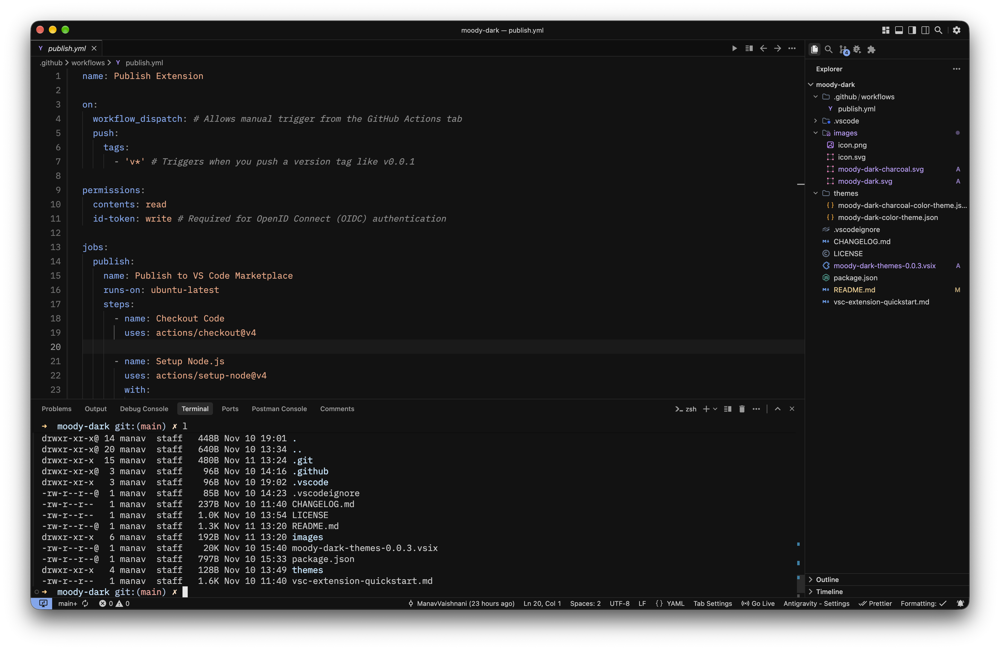
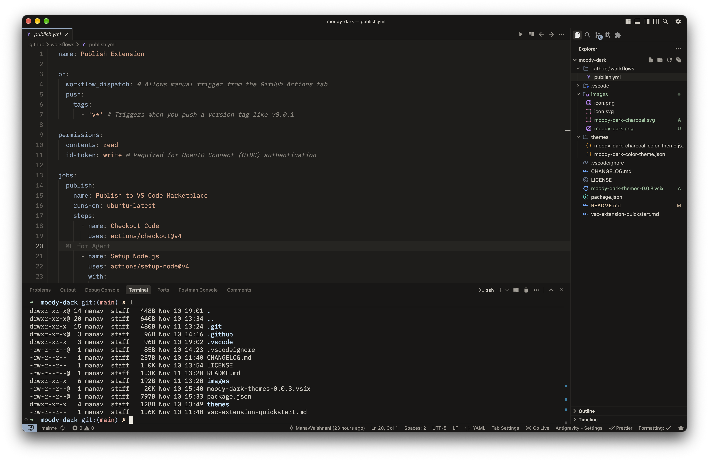
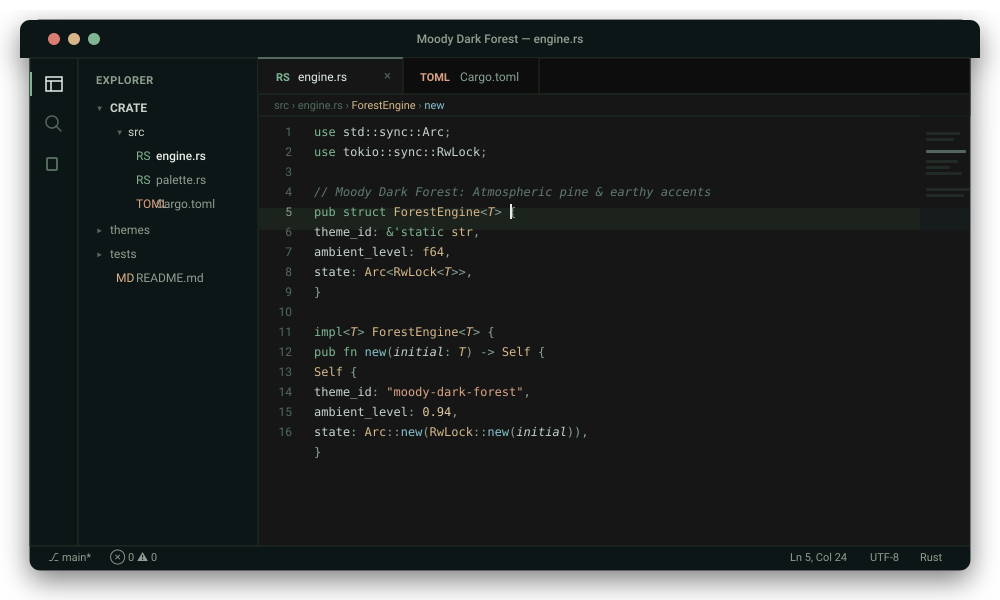

# Moody Dark Themes

Moody Dark Themes is a collection of calm, low-contrast dark themes for Visual Studio Code, designed to reduce eye strain during long coding sessions.

## Themes

### Moody Dark

A deep near-black theme with cool blue, lavender, and warm peach accents. Designed for high focus and reduced eye fatigue during long coding sessions.

### Moody Dark Charcoal

A softer charcoal theme with warm gray tones and muted blue accents. Tailored for comfortable contrast in ambient and lower-light environments.

### Moody Dark Forest

A deep pine-black theme inspired by damp evergreen forests, featuring sage emerald, frost cyan, and warm barley gold accents.

## Installation

1. Open Visual Studio Code.
2. Open the Extensions view.
3. Search for **Moody Dark Themes**.
4. Install the extension.
5. Open the Command Palette and run **Preferences: Color Theme**.
6. Select **Moody Dark**, **Moody Dark Charcoal**, or **Moody Dark Forest**.

## Development

To try the themes locally:

1. Clone or download this repository.
2. Open the project folder in Visual Studio Code.
3. Press `F5` to open an Extension Development Host window.
4. Select a theme from the Color Theme picker.

Changes to the theme files are applied automatically in the Extension Development Host window.

## License

This project is released under the MIT License.
